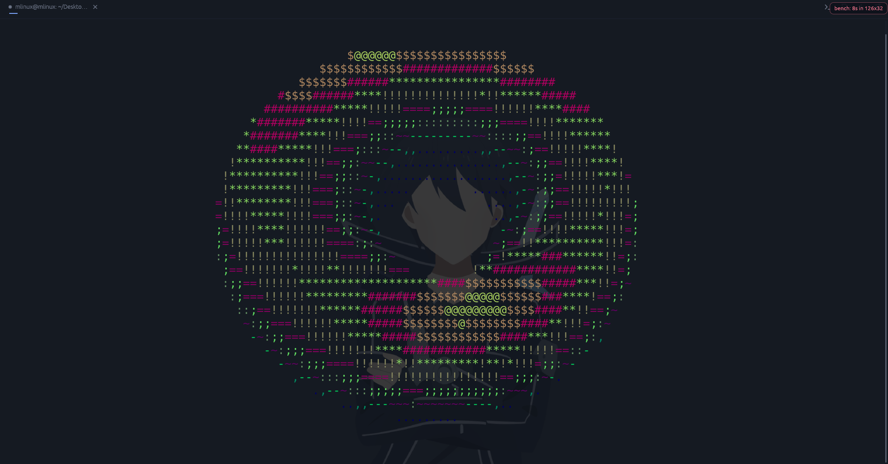

<p align="center">
  
</p>

# cl2metal

A sleek, minimal, secure terminal + SSH client — GPU-rendered with `wgpu` and
`egui`, a pure-Rust SSH stack (`russh`), a modal editor built in, and a
consent-gated MCP broker that lets local coding agents use your SSH profiles.



*The `:bench` spinning-torus benchmark, rendered through the terminal's own
glyph grid.*

## Highlights

- **Terminal** — GPU-instanced rendering, scrollback with search, OSC 8
  hyperlinks, OSC 52 clipboard, the Kitty keyboard protocol, OSC 133 shell
  integration (prompt marks, exit-status dot, jump-to-prompt), panes and tabs
  that open in the current directory, background image, visual bell.
- **SSH** — password / public-key / agent / MFA auth, jump hosts, local,
  remote and SOCKS5 forwards, `~/.ssh/config` import, reconnect in place,
  secrets in the OS keyring, an SFTP browser, and remote files in the editor.
- **Editor** — Vim-style modal editing with multiple cursors, splits, a file
  tree that follows the shell's `cd`, syntax highlighting, find/replace and
  editable keybindings; local and remote files live in the same editor.
- **Agents** — the built-in MCP server hands your SSH profiles to coding
  agents, one Allow click at a time (below).
- **Startup** — one short tip per launch (the drag-an-image hint on a fresh
  install), and a release check that offers to update in your terminal.

The full detail — every keybinding, config key, internal command, platform
note and the source layout — is in [features.md](features.md).

## Install

macOS / Linux:

```sh
curl -fsSL https://raw.githubusercontent.com/flawme/cl2metal/master/install.sh | sh
```

or, with wget:

```sh
wget -qO- https://raw.githubusercontent.com/flawme/cl2metal/master/install.sh | sh
```

Windows (PowerShell):

```powershell
iex (irm https://raw.githubusercontent.com/flawme/cl2metal/master/install.ps1)
```

Both download the latest release binary for your OS and architecture, verify
the published checksum, and install to `~/.local/bin` (Linux/macOS) or
`%LOCALAPPDATA%\cl2metal` (Windows), telling you if the directory is not on
your `PATH` yet — then ask, yes or no, whether to add the app to your
application menu / Start Menu / `~/Applications`. The Linux binary is built
against a glibc 2.35 baseline, and the Windows one links its C runtime
statically, so one download runs on older desktops without extra packages.

cl2metal checks for a newer release when it starts; when one exists, the
prompt's Update button opens your terminal and runs the same installer.

From source instead:

```sh
git clone https://github.com/flawme/cl2metal && cd cl2metal
cargo build --release
```

Requires a Vulkan / Metal / DX12-capable GPU. Building on Windows additionally
needs CMake on `PATH` (the SSH crypto backend builds C with it).

## MCP agent access

`cl2metal mcp` runs a local MCP server that lets coding agents — Claude Code,
Codex, Antigravity, Cursor, Windsurf, Sarvam Code — use the SSH profiles saved
in the running app:

- **Local only.** A unix-domain socket under `$XDG_RUNTIME_DIR` (with a `/tmp`
  fallback), accepting connections from your own user only, verified by peer
  credentials. There is no network listener.
- **Consent-gated.** Every `connect` pops an Allow / Deny dialog. Every
  command is screened: known read-only ones (`ls`, `cat` on a plain file,
  `git status`, …) run without asking; everything else pops an approval that
  shows the exact command. Anything touching `.env`, dotfiles or key material
  always asks. No answer within 120 s counts as a denial.
- **Audited.** Every approval, denial and timeout is written to
  `~/.local/state/cl2metal/agent-audit.log`.
- **One command to wire up.** Type `:mcp-on` inside cl2metal and it registers
  the server into every agent host it finds on the machine — append and merge
  only, never touching a config it cannot parse.

The tools it exposes are `list_profiles`, `connect`, `exec` and `close`. One
"Allow all future commands" click covers the rest of that session. Both
switches live in Settings → Security and default to on: *Let local coding
agents use SSH profiles (MCP)* and *Approve agent commands before they run
(read-only ones excepted)*.

`cl2metal mcp skill` prints the ready-to-use agent skill document.

## Platforms

Linux is the primary target; Windows and macOS build and run from the same
tree. CI runs fmt, clippy and the test suite on all three. **Windows and Linux
have been tested on real hardware.** macOS is CI-verified (Apple-silicon
runners) but has not been driven hands-on yet. Platform notes:
[features.md#platforms](features.md#platforms).

## License

[MIT](LICENSE)
